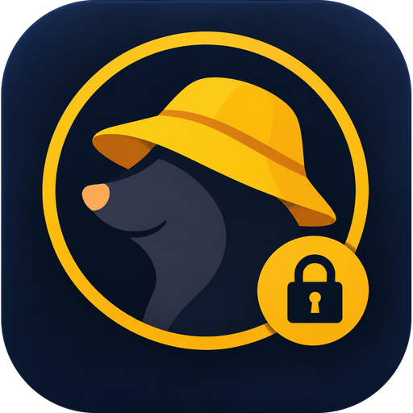
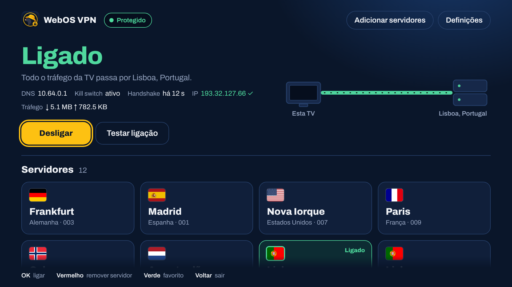
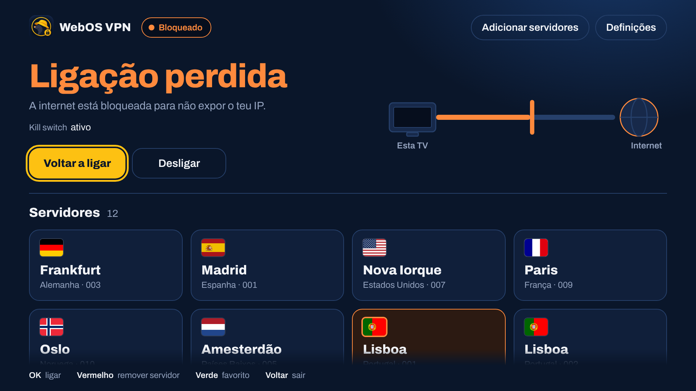
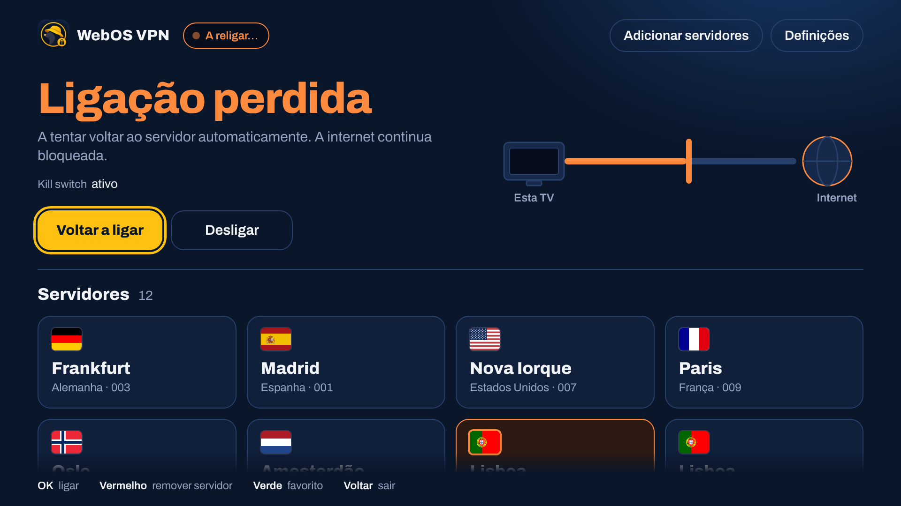
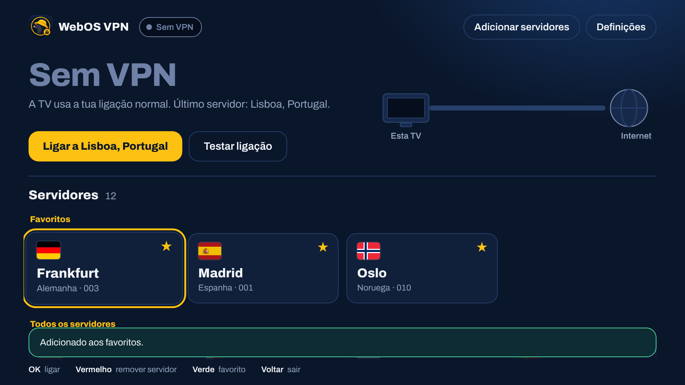
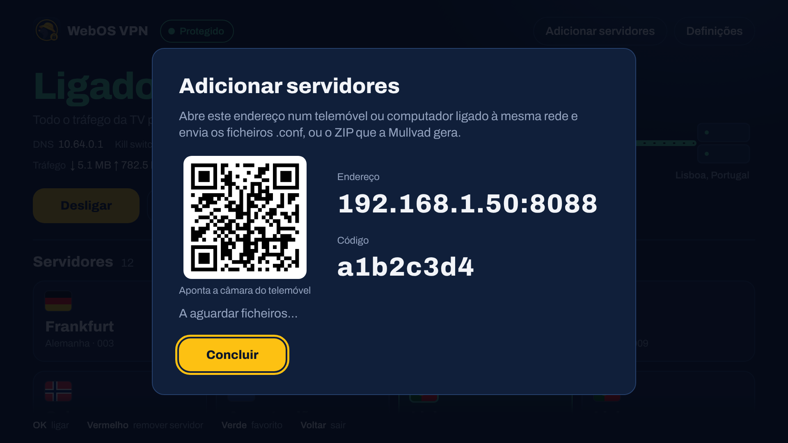
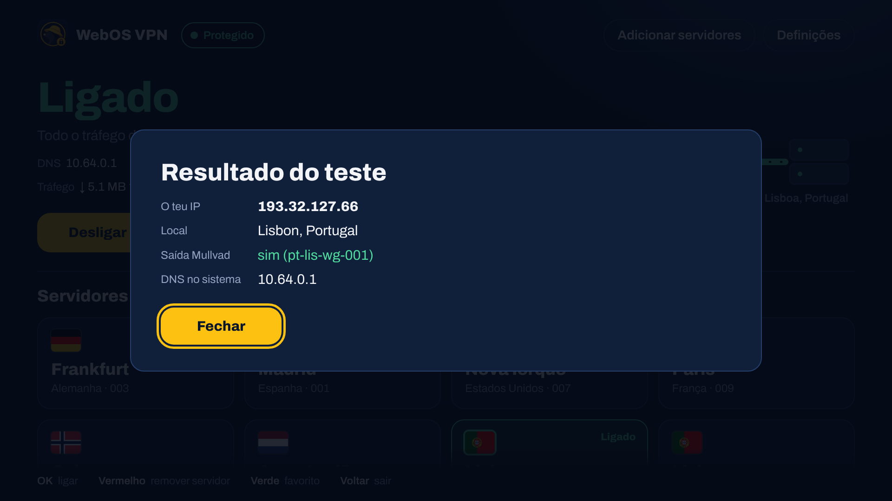
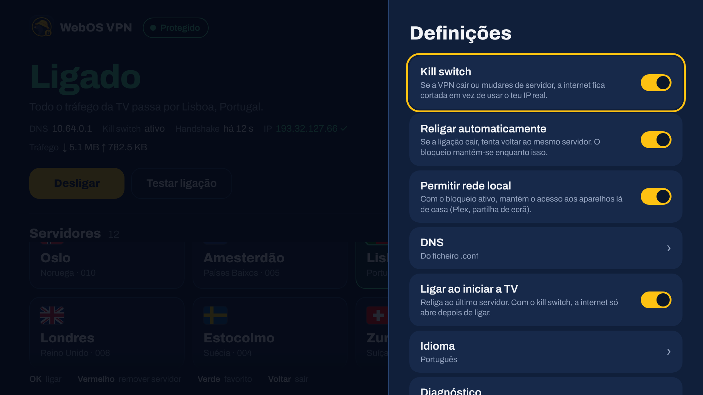
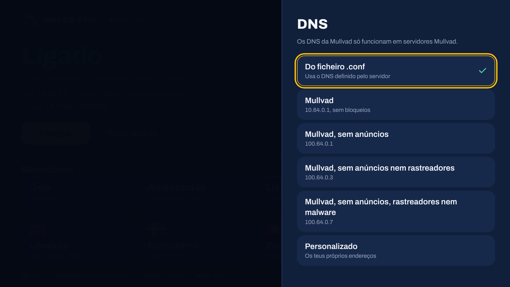
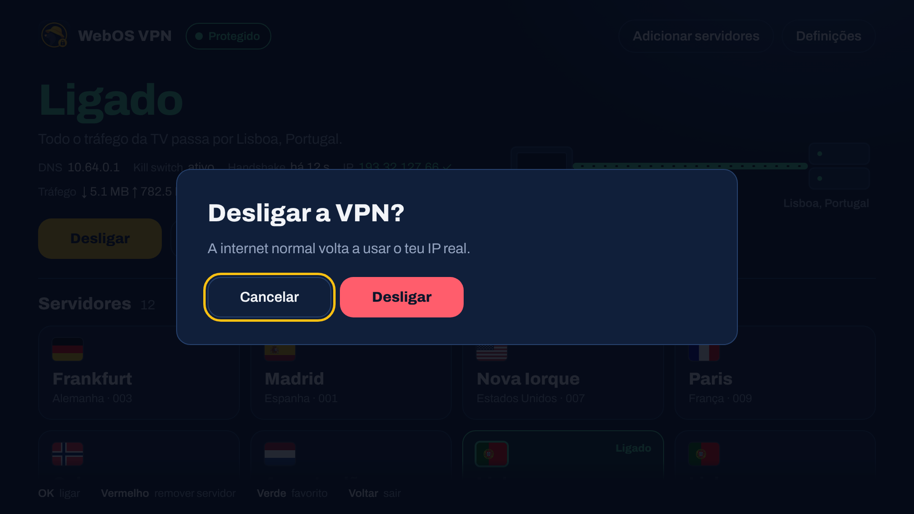

# WebOS VPN

Cliente WireGuard para TVs LG webOS com root (Homebrew Channel), pensado para a Mullvad: **vários servidores**, **DNS da Mullvad** e **kill switch**.

Parte do projeto [webos-wireguard](https://github.com/RodriguezCF/webos-wireguard) (MIT), reaproveitando o `wireguard-go` e o `wg` que ele já traz, e reescreve a interface e a lógica de ligação.



## Capturas de ecrã

Ecrã 1920×1080, como aparece na TV.

| | |
|---|---|
| <br>**Ligado e protegido**: indicador verde, IP verificado | <br>**Ligação perdida**: internet bloqueada pelo kill switch |
| <br>**A religar** sozinho ao mesmo servidor | <br>**Favoritos** no topo (tecla verde) |
| <br>**Adicionar servidores** por QR code | <br>**Testar ligação**: IP, país, saída Mullvad e DNS |
| <br>**Definições**: kill switch, religar, rede local, DNS | <br>**DNS** da Mullvad, com bloqueio de anúncios e mais |
| <br>**Confirmação** antes de expor o IP real | |

## O que muda em relação ao original

| | webos-wireguard | WebOS VPN |
|---|---|---|
| Servidores | um único `wg0.conf` | **quantos quiseres**, com troca em dois cliques |
| Importar | um ficheiro de cada vez | **vários `.conf` de uma vez, ou o ZIP da Mullvad** |
| DNS | ignorado | **aplicado** (do `.conf`, Mullvad, bloqueio de anúncios/rastreadores/malware, ou personalizado) |
| Se a VPN cair | a TV fica a usar o teu IP real | **a internet é cortada** (kill switch) |
| Trocar de servidor | corta e volta a ligar sem proteção pelo meio | **sem janela de fuga**: o bloqueio mantém-se durante a troca |
| Início automático | liga depois do arranque | o **bloqueio carrega logo no arranque**, antes de a rede subir |
| Se a ligação cair | fica à espera de ti | **religa sozinho** ao mesmo servidor (com o bloqueio mantido) |
| Verificação | só manual | **teste automático de fugas** ao ligar: indicador verde/vermelho no canto |
| Interface | consola de texto | ecrã para TV, com **bandeiras dos países**, diagrama do caminho da ligação, em português e inglês |

## Como o kill switch funciona

Com o kill switch ligado (por defeito), enquanto usas a VPN só podem sair da TV:

- tráfego pelo túnel;
- o pacote UDP até ao endereço do servidor WireGuard, para o túnel conseguir ligar;
- DHCP;
- a rede local (opcional, ligada por defeito): para continuares a aceder ao Plex, à partilha de ecrã, etc.

**Todo o resto é rejeitado.** O IPv6 é bloqueado por firewall se a TV tiver `ip6tables`; caso contrário a app desativa o IPv6 na interface de rede enquanto a VPN está ativa (como o projeto original). Isto vale em três momentos que contam:

1. **o túnel cai ou o processo morre**: a internet fica cortada, em vez de passar a usar o teu IP real;
2. **trocas de servidor**: as regras mudam numa só transação, por isso não há instante sem bloqueio;
3. **arranque da TV**: com o início automático, o bloqueio é carregado antes de esperar pela rede.

**DNS.** O DNS para fora do túnel é bloqueado, e qualquer consulta à porta 53 que tente sair é redirecionada para o DNS da VPN (isto apanha apps que ignoram o `resolv.conf`). Além disso o `/etc/resolv.conf` passa a apontar para o DNS escolhido, protegido contra reescrita, e é restaurado ao desligar.

O ecrã diz-te sempre a verdade sobre o estado:


*Ligação perdida, internet bloqueada.* Se o kill switch estiver desligado e a ligação cair, o ecrã fica **vermelho** com a linha a ir direta à Internet: é o aviso de que a TV está exposta.

### O que o kill switch não faz

- Não protege contra uma TV sem `iptables` (a app recusa ligar nesse caso, em vez de fingir que protege; podes desligar o kill switch nas definições).
- Não filtra tráfego de entrada nem faz *split tunneling*.
- Só IPv4 (o IPv6 é bloqueado, não encaminhado). Entre o arranque da TV e a execução do script de arranque há sempre uma janela curta que nenhuma app consegue cobrir.
- A rede local fica aberta se ativares "Permitir rede local". Os endereços privados não expõem o teu IP público.

## Requisitos

- LG webOS com **root e Homebrew Channel**. Os binários são ARMv7 estáticos, como os do original.
- Uma conta Mullvad com chave WireGuard registada (ou qualquer outro serviço WireGuard com ficheiros `.conf`).

## Instalar

1. Compila o IPK (`scripts/build.sh`) ou descarrega-o da página de *releases*.
2. Instala no teu método habitual: *Dev Manager* do webosbrew, `ares-install`, ou "Install from URL" do Homebrew Channel.
3. Abre **WebOS VPN**. Na primeira vez carrega em **Preparar**.

## Adicionar servidores da Mullvad

1. Em mullvad.net → *Account* → *WireGuard configuration*, gera uma chave (ou usa a que já tens).
2. Escolhe a plataforma **Linux**, seleciona os países, cidades ou servidores que queres e carrega em **Download zip archive**. Um servidor sozinho também serve (`.conf`).
3. Na TV: **Adicionar servidores**. A TV mostra um endereço e um código.
4. No telemóvel ou computador **na mesma rede**, **lê o QR code** com a câmara (o código já vem preenchido), ou abre o endereço e escreve o código, e envia o ZIP (ou vários `.conf`).

Os servidores aparecem na grelha, agrupados por país e cidade. A página fecha sozinha ao fim de 10 minutos ou após 5 códigos errados.

> Cada `.conf` contém uma chave privada. Ficam guardados na TV com permissões `600` e são apagados em **Definições → Remover tudo**.

## Usar

| Para | Faz |
|---|---|
| Ligar ou trocar de servidor | foca o cartão e prime **OK** |
| Desligar (volta à ligação normal) | botão **Desligar** |
| Remover um servidor | foca o cartão e prime a tecla **Vermelha** |
| Marcar como favorito | foca o cartão e prime a tecla **Verde** (os favoritos aparecem primeiro) |
| Ver o teu IP e se sais pela Mullvad | **Testar ligação** |
| Escolher DNS, kill switch, início automático | **Definições** |

Alterar o kill switch, a rede local ou o DNS **aplica-se logo** à ligação ativa, sem a reiniciar.

### Indicador de estado e verificação de fugas

O indicador no canto superior esquerdo está sempre visível:

| Indicador | Significa |
|---|---|
| **Protegido** (verde) | o teste automático confirmou que sais pela Mullvad e o DNS é o da VPN |
| **Possível fuga** (vermelho) | o teste diz que o tráfego não sai pela Mullvad, ou o DNS do sistema não é o da VPN |
| **Ligado** (azul) | ligado, mas sem veredicto (servidor que não é Mullvad, ou a TV não consegue fazer o teste) |
| **Bloqueado** / **A religar…** (âmbar) | sem VPN com a internet cortada pelo kill switch / a tentar voltar |
| **Exposto** (vermelho) | sem VPN **e sem kill switch**: a TV usa o teu IP real |

O teste corre sozinho ao ligar, depois de cada religação automática e de 10 em 10 minutos. Carrega no indicador para ver os detalhes. Ao **Desligar** com o kill switch ativo, a app pergunta antes, porque a internet normal volta a mostrar o teu IP real.

### Religar automaticamente

Se o túnel cair, um processo em segundo plano tenta voltar ao mesmo servidor, com pausas crescentes (5, 10, 20, 40, 60 s). O kill switch mantém a internet cortada durante as tentativas. Desligar por ti nunca religa. Podes desativar em **Definições**.

### DNS

| Opção | Endereço |
|---|---|
| Do ficheiro `.conf` | o que o servidor define (Mullvad: `10.64.0.1`) |
| Mullvad | `10.64.0.1` |
| Mullvad, sem anúncios | `100.64.0.1` |
| Mullvad, sem anúncios nem rastreadores | `100.64.0.3` |
| Mullvad, sem anúncios, rastreadores nem malware | `100.64.0.7` |
| Personalizado | os teus endereços |

Os endereços `100.64.0.x` só funcionam em servidores Mullvad, e são os mesmos que a Mullvad documenta (bits: anúncios 1, rastreadores 2, malware 4, conteúdo adulto 8, jogo 16, redes sociais 32). Para outras combinações usa **Personalizado**.

## Se ficares sem internet

O ecrã da app funciona sempre, mesmo sem internet. Abre-a e carrega em **Desbloquear internet** (ou **Desligar**).

Por SSH, se a app não abrir:

```sh
/var/lib/webosbrew/webosvpn/scripts/disconnect.sh   # desliga e retira o bloqueio
rm /var/lib/webosbrew/init.d/90-webosvpn            # sem início automático
```

As regras de firewall não sobrevivem a um reinício. Com o início automático ligado, o bloqueio volta a carregar no arranque até a ligação ser feita: é intencional.

## Como foi testado (e o que não foi)

**Testado automaticamente neste repositório:**

- 9 testes do importador e da página de envio (formato Mullvad, comentários, maiúsculas, chaves inválidas, ZIP, caminhos maliciosos, vários ficheiros por envio, sessão por código).
- 69 verificações de ponta a ponta com **tráfego real** entre dois *network namespaces* (a "TV" e a "Internet"), com `iptables`, rotas, `mount` e `resolv.conf` verdadeiros. Entre elas: nada chega à Internet quando o túnel cai; durante uma troca de servidor, com sondas a cada 20 ms, **nenhum pacote saiu fora do túnel**; o DNS não vai em claro; a reconexão automática volta sozinha **sem nenhum pacote fora do túnel** durante a queda; tudo é restaurado ao desligar.
- 76 verificações da interface num Chromium a 1920×1080: estados, bandeiras, rolagem das definições, foco do comando, tecla Voltar e vermelha, comandos enviados à TV.

**Não testado:**

- **Numa TV real.** Nunca correu num OLED C5 nem em nenhuma TV. Os binários `wg` e `wireguard-go` foram substituídos por simuladores nos testes de ponta a ponta (o sandbox não tem módulo WireGuard), por isso o **handshake e a encriptação não foram exercitados**: são os binários do projeto original, sem alterações.
- Se o `iptables` do teu webOS aceita todas as regras (`REJECT`, `nat`, `iptables-restore`). Há alternativas se algum faltar (usa `DROP`; sem `nat`, o bloqueio de DNS continua a valer), mas só a TV confirma.
- Se `/etc/resolv.conf` na TV aceita o *bind mount*. Se não aceitar, a app escreve diretamente no ficheiro e restaura ao desligar.
- Se o `curl` da TV tem certificados HTTPS para o **Testar ligação**.

**Checklist para o primeiro uso:**

1. Preparar → Adicionar um servidor → Ligar. Deve passar a **Ligado** em poucos segundos.
2. **Testar ligação**: o IP deve ser da Mullvad e "Saída Mullvad: sim".
3. Por SSH: `killall wireguard-go`. A internet deve **cortar** e o ecrã ficar âmbar ("Ligação perdida").
4. **Desbloquear internet** deve repor a ligação normal.
5. Se algo falhar: **Definições → Diagnóstico** mostra o estado, as regras, as rotas e os registos (sem chaves). Envia isso.

## Desenvolvimento

```sh
scripts/build.sh    # testes Go, compila o ajudante para ARMv7, valida os scripts, cria o IPK em dist/
scripts/test.sh     # Go + ponta a ponta (precisa de root) + interface (precisa de playwright)
```

```
app/com.heisenberg.webosvpn/   interface (index.html, css, js) e payload instalado na TV
  payload/webosvpn/scripts/    connect, disconnect, state, settings, profiles, boot, ...
uploader/                      wgtv: importador, página de envio, resolução de endpoints (Go)
tests/                         e2e.sh (namespaces), ui.py (Chromium), stubs
```

## Aviso

Projeto independente e não oficial: **não é feito, apoiado nem afiliado à Mullvad VPN AB** nem à LG. "Mullvad" e "LG" são marcas dos respetivos titulares e são usadas apenas para indicar compatibilidade. O ícone da app é da responsabilidade do autor do repositório.

## Licença

MIT (ver `LICENSE`). Componentes de terceiros em [THIRD_PARTY.md](THIRD_PARTY.md).
